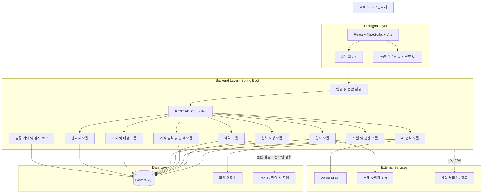
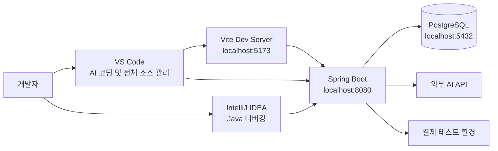
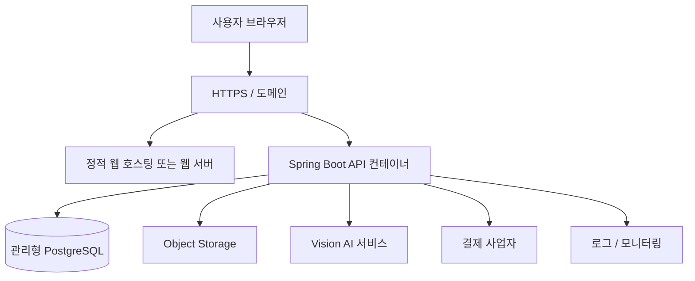
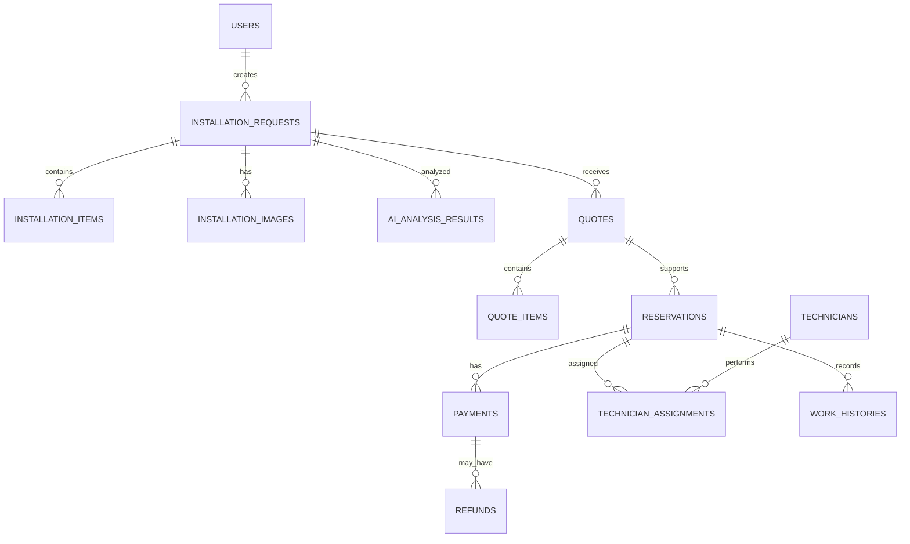

# 시스템 아키텍처 설계서 (Architecture Design)

- **프로젝트명:** AI 기반 가전제품 이전설치 플랫폼
- **영문명:** Appliance Installation Platform
- **문서 버전:** 1.0
- **작성일:** 2026-10-19
- **개발 단계:** PoC 및 MVP
- **관련 문서:** `requirements.md`, `database.md`, `api-spec.md`, `coding-rules.md`
- **문서 목적:** 시스템 구성, 애플리케이션 구조, 모듈 간 책임, 데이터 흐름, 외부 시스템 연계 및 배포 구조를 정의한다.

---

## 1. 아키텍처 설계 개요

### 1.1 설계 목표

본 시스템은 고객이 가전제품 이전설치를 신청하고 AI 분석, 자동 견적, 예약, 결제 및 기사 배정까지 처리할 수 있는 웹 기반 통합 플랫폼이다.

다음 설계 목표를 따른다.

1. 프론트엔드와 백엔드를 하나의 Git 저장소에서 통합 관리한다.
2. 프론트엔드와 백엔드는 독립적으로 빌드하고 실행한다.
3. 백엔드는 모듈형 모놀리스 구조로 구현하여 초기 개발 복잡도를 줄인다.
4. 업무 기능별 모듈 경계를 명확히 하여 향후 서비스 분리가 가능하도록 한다.
5. AI, 결제, 파일 저장소 등 외부 서비스는 어댑터를 통해 연계한다.
6. 데이터 무결성, 권한 검증, 예약 동시성 및 결제 중복 처리를 보장하도록 설계한다.
7. Docker 기반 개발 환경을 제공하고, 운영 클라우드는 추후 결정할 수 있도록 한다.
8. AI 코딩 에이전트가 문서를 기준으로 모듈별 기능을 독립적으로 구현할 수 있도록 한다.

### 1.2 핵심 아키텍처 원칙

| 원칙 | 설계 내용 |
|---|---|
| 단순성 | 초기에는 마이크로서비스보다 모듈형 모놀리스 채택 |
| 모듈 독립성 | 회원, 설치 요청, AI, 견적, 예약, 결제, 기사 기능 분리 |
| 단일 진실 공급원 | 확정된 업무 상태와 금액은 백엔드 및 DB에서 관리 |
| API 우선 | 프론트엔드와 백엔드의 API 계약을 먼저 정의 |
| 외부 연계 분리 | AI 및 결제 사업자별 구현을 어댑터로 격리 |
| 데이터 일관성 | 트랜잭션, 제약조건, 멱등성 및 상태 전이 규칙 적용 |
| 보안 기본 적용 | 서버 측 권한 검증, 비밀정보 분리, 감사 로그 적용 |
| 점진적 확장 | 트래픽과 운영 요구가 증가하면 필요한 모듈부터 분리 |

---

## 2. 전체 시스템 아키텍처

### 2.1 논리 아키텍처



### 2.2 구성요소별 책임

| 구성요소 | 책임 |
|---|---|
| React 프론트엔드 | 화면 표시, 입력 검증, API 호출, 사용자 피드백 |
| API Client | HTTP 통신, 공통 오류 처리, 인증 정보 전달 |
| Spring Security | 인증, 역할 및 요청 접근 권한 검증 |
| REST API Controller | 요청 검증, 서비스 호출, 응답 DTO 반환 |
| 업무 모듈 | 각 도메인의 업무 규칙과 상태 전이 처리 |
| PostgreSQL | 사용자, 요청, 견적, 예약, 결제 및 작업 데이터 저장 |
| 파일 저장소 | 이미지 원본과 작업 증빙 파일 저장 |
| Vision AI API | 이미지 및 설치 환경 분석 |
| 결제 사업자 | 결제 승인, 취소, 환불 및 웹훅 이벤트 처리 |
| Redis | 필요 시 분산 잠금, 캐시 및 임시 데이터 관리 |
| 공통 모듈 | 예외 처리, 로그, 감사 이력 및 공통 응답 처리 |

---

## 3. 시스템 배포 아키텍처

### 3.1 개발 환경

개발 환경에서는 프론트엔드, 백엔드, 데이터베이스를 각각 독립적으로 실행한다.



개발 환경 구성:

- VS Code: 전체 프로젝트 및 AI 코딩 에이전트
- IntelliJ IDEA: 백엔드 실행, 디버깅 및 테스트
- Vite: 프론트엔드 개발 서버
- Spring Boot: REST API 서버
- Docker Compose: PostgreSQL 실행
- Git: 변경 이력 및 협업 관리

개발 시 Vite 프록시를 사용하여 `/api` 요청을 Spring Boot로 전달한다.

### 3.2 운영 환경 논리 구조



운영 환경은 다음과 같이 구성한다.

1. 프론트엔드는 정적 파일로 빌드하여 CDN 또는 웹 서버에서 제공한다.
2. 백엔드는 Docker 이미지로 패키징하여 컨테이너 환경에서 실행한다.
3. PostgreSQL은 백업과 복구 기능을 제공하는 관리형 DB를 우선 검토한다.
4. 이미지는 DB에 직접 저장하지 않고 Object Storage에 저장한다.
5. 비밀키는 클라우드 비밀 관리 서비스 또는 안전한 환경변수 주입 방식으로 관리한다.
6. 외부 통신은 HTTPS를 사용한다.
7. DB는 애플리케이션에서 필요한 네트워크만 허용하고 공개 인터넷에 직접 노출하지 않는다.

클라우드 사업자는 확정하지 않는다. AWS, Azure 등은 비용, 네트워크, 백업, 운영 편의성 및 기존 시스템 연계 요건을 비교한 뒤 선택한다.

---

## 4. 백엔드 애플리케이션 아키텍처

### 4.1 설계 방식

백엔드는 Spring Boot 기반의 모듈형 모놀리스로 개발한다.

모듈형 모놀리스란 하나의 Spring Boot 애플리케이션으로 배포하되, 내부 코드를 업무 기능별 모듈로 분리하는 구조다.

초기에는 단일 애플리케이션으로 운영하여 배포와 트랜잭션 관리를 단순화한다. 모듈 간 의존성은 제한하여 향후 AI 분석이나 결제 기능을 별도 서비스로 분리할 수 있도록 한다.

### 4.2 백엔드 디렉터리 구조

```text
backend/
├── pom.xml
├── mvnw
├── mvnw.cmd
└── src/
    ├── main/
    │   ├── java/
    │   │   └── com/arcsion/platform/
    │   │       ├── AppliancePlatformApiApplication.java
    │   │       │
    │   │       ├── global/
    │   │       │   ├── config/
    │   │       │   ├── security/
    │   │       │   ├── exception/
    │   │       │   ├── response/
    │   │       │   ├── logging/
    │   │       │   └── util/
    │   │       │
    │   │       └── domain/
    │   │           ├── member/
    │   │           ├── appliance/
    │   │           ├── installation/
    │   │           ├── ai/
    │   │           ├── quote/
    │   │           ├── reservation/
    │   │           ├── payment/
    │   │           ├── technician/
    │   │           ├── assignment/
    │   │           └── admin/
    │   │
    │   └── resources/
    │       ├── application.yml
    │       ├── application-local.yml
    │       ├── application-test.yml
    │       └── db/
    │           └── migration/
    │
    └── test/
        └── java/com/arcsion/platform/
```

각 도메인 모듈은 필요에 따라 다음 구조를 따른다.

```text
domain/installation/
├── controller/
├── service/
├── repository/
├── entity/
├── dto/
├── mapper/
└── exception/
```

초기에는 기능이 단순한 모듈의 불필요한 패키지를 만들지 않아도 된다. 기능이 늘어나면 같은 규칙으로 확장한다.

### 4.3 계층별 책임

| 계층 | 책임 | 금지 사항 |
|---|---|---|
| Controller | HTTP 요청, 검증, 응답 변환 | 복잡한 업무 규칙 구현 |
| Service | 업무 규칙, 트랜잭션, 상태 전이 | HTTP 요청 객체에 대한 과도한 의존 |
| Repository | 데이터 조회 및 저장 | 프레젠테이션 처리 |
| Entity | 도메인 상태와 영속성 표현 | API 응답 전용 모델로 직접 노출 |
| DTO | 요청 및 응답 데이터 표현 | 업무 규칙의 중복 구현 |
| Adapter | 외부 서비스 연계 | 외부 사업자별 코드를 업무 핵심 로직에 혼합 |
| Global | 보안, 공통 예외, 설정, 관측성 | 특정 업무 모듈에 대한 과도한 의존 |

### 4.4 모듈 간 의존성 규칙

- Controller는 해당 도메인의 Service를 호출한다.
- Service는 Repository와 허용된 도메인 인터페이스를 사용한다.
- Repository는 DB 영속성 처리를 담당한다.
- 외부 API는 Adapter 인터페이스를 통해 호출한다.
- 다른 모듈의 Repository를 직접 호출하지 않는다.
- 업무 상태 변경은 해당 도메인의 Service를 통해서만 수행한다.
- 순환 의존성이 발생하지 않도록 한다.
- 모듈 간 비동기 처리가 필요하면 이벤트 또는 작업 큐 도입을 검토한다.

---

## 5. 프론트엔드 아키텍처

### 5.1 설계 방식

React + TypeScript + Vite를 사용하며 화면, 공통 컴포넌트, API 통신, 도메인별 기능을 분리한다.

초기에는 React Router를 이용한 단일 웹 애플리케이션으로 구현한다. 고객, 기사, 관리자 화면은 공통 레이아웃과 도메인별 페이지를 구분한다.

### 5.2 프론트엔드 디렉터리 구조

```text
frontend/
├── package.json
├── vite.config.ts
├── tsconfig.json
└── src/
    ├── main.tsx
    ├── App.tsx
    │
    ├── app/
    │   ├── router.tsx
    │   ├── providers/
    │   └── layouts/
    │
    ├── api/
    │   ├── client.ts
    │   ├── error-handler.ts
    │   └── endpoints.ts
    │
    ├── components/
    │   ├── common/
    │   ├── form/
    │   ├── modal/
    │   └── feedback/
    │
    ├── features/
    │   ├── auth/
    │   ├── appliances/
    │   ├── installation/
    │   ├── ai-analysis/
    │   ├── quotes/
    │   ├── reservations/
    │   ├── payments/
    │   ├── technician/
    │   └── admin/
    │
    ├── hooks/
    ├── types/
    ├── utils/
    └── styles/
```

### 5.3 프론트엔드 책임

- 화면 렌더링과 사용자 입력 처리
- 필수 입력값 및 형식 검증
- 공통 API 클라이언트를 통한 서버 통신
- API 오류와 로딩 상태 표시
- 인증 상태에 따른 화면 및 메뉴 구성
- 고객·기사·관리자별 라우팅
- 서버에서 반환된 상태와 가격을 일관되게 표시

프론트엔드의 권한별 메뉴 제어는 사용자 경험을 위한 기능이다. 실제 데이터 접근 권한은 항상 백엔드에서 검증한다.

### 5.4 API 통신 규칙

- API 기본 경로는 `/api/v1`을 사용한다.
- 요청과 응답은 JSON을 기본으로 한다.
- 파일 업로드는 `multipart/form-data`를 사용한다.
- 인증 방식에 따라 공통 클라이언트에서 쿠키 또는 인증 헤더를 처리한다.
- 오류 응답은 공통 형식으로 처리한다.
- API의 요청·응답 타입은 백엔드 DTO와 일치시킨다.
- 운영 환경에서 프론트엔드와 API의 도메인이 다르면 CORS 및 쿠키 정책을 별도로 설정한다.

---

## 6. 도메인 모듈 설계

### 6.1 회원 및 인증 모듈

**책임**

- 회원가입 및 로그인
- 로그아웃 및 인증 상태 관리
- 비밀번호 변경
- 사용자 프로필 관리
- 역할 및 계정 상태 관리

**주요 구성**

- MemberController
- MemberService
- MemberRepository
- AuthenticationService
- UserDetailsService 또는 동등한 인증 구성요소

인증 토큰 또는 세션의 수명, 로그아웃 처리, 비밀번호 해시, 계정 정지 및 관리자 권한 검증을 구현한다.

### 6.2 가전제품 및 설치 요청 모듈

**책임**

- 제품 종류 및 제품 정보 관리
- 출발지·도착지와 희망 일정 관리
- 설치 환경 입력
- 요청별 제품 목록 및 이미지 연결
- 설치 요청의 상태 전이 관리

설치 요청은 AI 분석, 견적, 예약 및 작업 이력과 연결되는 핵심 업무 엔터티다.

### 6.3 AI 분석 모듈

**책임**

- 이미지 분석 요청 생성
- 이미지 저장소 접근
- Vision AI 서비스 호출
- 분석 상태와 결과 저장
- 분석 실패 및 재시도 처리
- 수동 검토 대상 지정

**내부 구성**

- AiAnalysisController
- AiAnalysisService
- VisionAiClient
- ImageStorageAdapter
- AiAnalysisRepository

외부 AI 공급자를 교체하더라도 핵심 업무 서비스의 변경을 최소화하도록 인터페이스를 분리한다.

분석이 오래 걸리면 작업 상태를 저장하고 비동기 처리로 확장한다. AI 응답을 무조건 신뢰하지 않고 결과의 불확실성과 검토 필요 여부를 함께 관리한다.

### 6.4 가격 규칙 및 견적 모듈

**책임**

- 제품별 기본 가격 관리
- 거리, 층수, 배관 등 추가 비용 규칙 관리
- 할인 및 추가 작업 정책 적용
- 견적 상세 항목 생성
- 견적 버전과 유효기간 관리
- 예외 견적의 수동 검토

가격 규칙 엔진은 별도의 도메인 서비스로 구현한다. AI 분석 모듈은 설치 조건 후보를 제공하고, 견적 모듈은 검증된 조건과 활성 가격 정책을 사용하여 최종 금액을 산출한다.

확정된 견적은 산출 당시의 가격 규칙 버전과 금액 상세를 보존한다.

### 6.5 예약 모듈

**책임**

- 예약 가능 일정 조회
- 예약 생성 및 변경
- 예약 취소
- 예약 만료 처리
- 중복 예약 방지
- 예약 상태 전이 관리

예약 확정은 트랜잭션과 DB 제약조건을 이용해 처리한다. 여러 서버에서 동시 예약이 발생하는 환경에서는 필요한 경우 Redis 잠금을 추가하되, DB의 무결성 검증을 함께 유지한다.

### 6.6 결제 모듈

**책임**

- 결제 요청 및 승인 상태 관리
- 결제 사업자 연계
- 웹훅 검증
- 중복 요청 및 중복 이벤트 방지
- 취소와 환불 처리
- 결제 상태 대사

**내부 구성**

- PaymentController
- PaymentService
- PaymentRepository
- PaymentProviderAdapter
- PaymentWebhookController

결제 사업자의 API 형식은 어댑터 내부에서 처리한다. 예약 금액을 서버에서 재검증하고, 외부 결제 승인 결과를 검증한 뒤 내부 상태를 갱신한다.

DB 트랜잭션과 외부 결제 승인은 하나의 원자적 트랜잭션이 아니므로, 실패 복구 및 대사 절차를 별도로 설계한다.

### 6.7 기사 및 배정 모듈

**책임**

- 기사 프로필과 작업 가능 품목 관리
- 서비스 지역 및 작업 일정 관리
- 기사 후보 검색
- 기사 배정과 수락·거절
- 작업 상태 변경
- 작업 완료 증빙 관리

초기 자동 배정은 다음 조건을 기준으로 규칙 기반으로 구현한다.

1. 해당 제품을 취급할 수 있는 기사인지 확인한다.
2. 작업 지역을 지원하는지 확인한다.
3. 예약 일정에 작업 가능 시간이 있는지 확인한다.
4. 필수 자격이나 장비 조건을 충족하는지 확인한다.
5. 적합한 후보 중 배정 우선순위 규칙에 따라 선정한다.

후보가 없으면 자동으로 임의 배정하지 않고 관리자 재배정 대상으로 전환한다.

### 6.8 관리자 모듈

**책임**

- 회원 및 기사 관리
- 설치 요청 및 AI 결과 검토
- 가격 규칙 관리
- 예약 및 기사 배정 관리
- 결제와 환불 이력 조회
- 중요 업무 감사 이력 조회

관리자 기능도 일반 업무 API와 동일하게 인증 및 권한 검증을 적용한다. 중요 변경에는 변경자, 변경 시각, 변경 대상 및 변경 결과를 기록한다.

---

## 7. 데이터 아키텍처

### 7.1 데이터 저장 원칙

PostgreSQL을 핵심 업무 데이터의 주 저장소로 사용한다.

다음 데이터를 관계형 테이블로 관리한다.

- 사용자와 역할
- 가전제품 및 설치 요청
- 이미지 메타데이터와 AI 분석 결과
- 가격 정책과 견적
- 예약과 결제
- 기사와 기사 배정
- 작업 이력과 감사 로그

이미지 원본은 Object Storage에 저장하고, DB에는 저장 위치, 파일 유형, 크기, 소유자, 연결된 업무 ID 등 메타데이터를 저장한다.

### 7.2 데이터 관계 개념



위 다이어그램은 개념 관계를 나타낸다. 실제 외래키, 선택적 관계, 유일성 및 삭제 정책은 `database.md`에서 상세 정의한다.

### 7.3 트랜잭션 원칙

- 하나의 업무 상태 변경에 필요한 DB 변경은 가능한 한 단일 트랜잭션으로 처리한다.
- 예약 중복은 DB 제약조건과 트랜잭션으로 방지한다.
- 결제 사업자 호출을 긴 DB 트랜잭션 안에서 불필요하게 유지하지 않는다.
- 외부 연계 실패 시 재시도 가능한 상태를 기록한다.
- 확정된 견적과 결제 이력은 업무 추적이 가능하도록 보존한다.
- 데이터 삭제는 업무 이력과 법적 보존 요건을 고려한다.

### 7.4 스키마 관리

- DB 스키마 변경은 Flyway 또는 동등한 마이그레이션 도구로 관리한다.
- 마이그레이션 파일은 Git에 포함한다.
- 운영 환경에서 Hibernate 자동 스키마 변경을 사용하지 않는다.
- 개발과 테스트 환경은 동일한 마이그레이션을 기준으로 구성한다.
- DB 변경 시 `database.md`를 함께 갱신한다.

---

## 8. 외부 시스템 연계 아키텍처

### 8.1 AI 서비스 연계

AI 분석 호출은 백엔드의 `VisionAiClient` 인터페이스를 통해 수행한다.

처리 흐름:

1. 고객이 설치 요청과 이미지를 등록한다.
2. 백엔드가 이미지 유형, 크기 및 접근 권한을 검증한다.
3. 이미지를 Object Storage에 저장한다.
4. 분석 요청 ID를 생성하고 분석 상태를 기록한다.
5. Vision AI 서비스에 분석을 요청한다.
6. 응답을 검증하고 분석 결과를 저장한다.
7. 결과와 검토 필요 여부를 고객 또는 관리자에게 제공한다.

설계 원칙:

- AI 인증키는 소스 코드에 포함하지 않는다.
- 요청 시간 제한과 오류 처리를 적용한다.
- 재시도는 제한된 횟수와 정책으로 수행한다.
- 분석 요청 및 응답 메타데이터를 추적한다.
- 불확실한 결과는 수동 검토 대상으로 처리한다.
- 대량 분석이 필요해지면 비동기 작업 큐 도입을 검토한다.

### 8.2 결제 서비스 연계

결제 처리는 `PaymentProviderAdapter` 인터페이스를 통해 수행한다.

처리 흐름:

1. 고객이 예약에 대한 결제를 요청한다.
2. 서버가 예약 상태와 결제 금액을 확인한다.
3. 결제 요청 ID와 멱등성 키를 생성한다.
4. 결제 사업자와 결제 절차를 진행한다.
5. 서버가 승인 결과 또는 웹훅을 검증한다.
6. 검증된 결과를 내부 결제 상태에 반영한다.
7. 예약 확정 조건이 충족되면 예약 상태를 갱신한다.
8. 오류나 불일치가 발생하면 재조회 및 대사 대상으로 기록한다.

결제 사업자와의 연계는 향후 다른 사업자로 교체할 수 있도록 업무 규칙과 분리한다.

### 8.3 파일 저장소 연계

`ImageStorageAdapter`를 통해 파일 저장 기능을 추상화한다.

- 개발: 로컬 파일 저장소 또는 개발용 Object Storage
- 운영: AWS S3, Azure Blob Storage 등 검토
- 파일 접근: 서버가 발급한 제한된 접근 URL 또는 인증된 API
- 파일 보안: 허용된 파일 유형, 크기 제한, 접근 권한 검증
- 저장 메타데이터: 파일 ID, 소유자, 업무 ID, 저장 위치, 생성 시각

운영 환경에서는 공개 버킷을 기본으로 사용하지 않는다. 민감한 이미지에는 접근 통제와 보존·삭제 정책을 적용한다.

### 8.4 Redis 도입 기준

Redis는 초기부터 필수 구성요소로 간주하지 않는다.

다음 조건이 확인되면 도입한다.

- 여러 백엔드 인스턴스에서 예약 충돌 방지를 위한 분산 잠금이 필요한 경우
- 캐시로 DB 부하를 줄여야 하는 경우
- 만료되는 임시 데이터나 작업 상태를 별도로 관리해야 하는 경우

예약의 최종 무결성은 Redis에만 의존하지 않고 DB 제약조건과 트랜잭션으로 보장한다.

---

## 9. 인증 및 보안 아키텍처

### 9.1 인증 방식

인증은 Spring Security를 기반으로 구현한다. JWT 또는 서버 세션 방식 중 하나를 선택해 일관되게 적용한다.

브라우저 기반 서비스에서는 HttpOnly 보안 쿠키를 통한 인증을 우선 검토한다. JWT를 쿠키에 저장하는 경우에도 쿠키 보안 속성, 만료, 재발급 및 폐기 정책을 정의해야 한다.

### 9.2 권한 검증

- 고객: 본인 설치 요청, 견적, 예약 및 결제에만 접근
- 기사: 본인에게 배정된 작업에만 접근
- 관리자: 별도 관리자 권한 검증 후 운영 기능 접근
- 비회원: 공개 정보만 접근
- 시스템 작업: 사용자 권한과 구분된 제한된 내부 권한 사용

리소스 소유권 검증은 서비스 계층에서 수행한다. 요청에 전달된 사용자 ID만 믿고 데이터를 반환하지 않는다.

### 9.3 보안 통제

- 비밀번호는 안전한 해시 알고리즘으로 저장한다.
- 운영 비밀키는 비밀 관리 시스템을 통해 주입한다.
- 인증 및 권한 오류는 적절한 HTTP 상태 코드로 반환한다.
- 쿠키 인증에는 CSRF 방어 정책을 적용한다.
- CORS는 허용된 출처만 지정한다.
- SQL Injection 방지를 위해 파라미터 바인딩을 사용한다.
- 파일 업로드와 다운로드에 접근 권한을 적용한다.
- 결제 웹훅은 서명과 중복 이벤트를 검증한다.
- 중요 업무 변경은 감사 로그에 기록한다.
- 개인정보와 인증 토큰은 일반 로그에 기록하지 않는다.

---

## 10. 공통 API 및 오류 처리 아키텍처

### 10.1 API 경로

모든 업무 API는 다음 기본 경로를 사용한다.

`/api/v1`

예시:

- `/api/v1/auth`
- `/api/v1/members`
- `/api/v1/appliances`
- `/api/v1/installation-requests`
- `/api/v1/ai-analyses`
- `/api/v1/quotes`
- `/api/v1/reservations`
- `/api/v1/payments`
- `/api/v1/technicians`
- `/api/v1/admin`

### 10.2 공통 응답 형식

성공 응답 예시:

```json
{
  "success": true,
  "data": {
    "requestId": "sample-request-id",
    "status": "SUBMITTED"
  },
  "error": null
}
```

오류 응답 예시:

```json
{
  "success": false,
  "data": null,
  "error": {
    "code": "VALIDATION_ERROR",
    "message": "입력값을 확인해 주세요.",
    "details": []
  }
}
```

위 JSON은 응답 규격 예시이며, 실제 필드와 HTTP 상태 코드는 `api-spec.md`에서 확정한다.

### 10.3 오류 처리 규칙

| 상황 | HTTP 상태 예시 | 처리 원칙 |
|---|---|---|
| 입력값 오류 | 400 | 필드별 검증 오류 반환 |
| 인증 실패 | 401 | 인증 절차 안내 |
| 권한 부족 | 403 | 접근 거부 |
| 리소스 없음 | 404 | 존재하지 않는 데이터 안내 |
| 업무 상태 충돌 | 409 | 현재 상태와 충돌 원인 안내 |
| 요청 제한 초과 | 429 | 재시도 제한 안내 |
| 외부 서비스 실패 | 502 또는 503 | 장애 기록 및 재시도 정책 적용 |
| 예상하지 못한 오류 | 500 | 내부 상세정보를 숨기고 오류 ID 제공 |

프론트엔드는 오류 코드에 따라 사용자 메시지를 표시하고, 백엔드는 상세 원인을 안전한 로그에 기록한다.

---

## 11. 비동기 처리 및 상태 관리

### 11.1 적용 대상

다음 업무는 처리 시간이 길거나 외부 시스템에 의존하므로 비동기 처리 가능성을 고려한다.

- AI 이미지 분석
- 분석 결과 재시도
- 예약 만료 처리
- 결제 결과 대사
- 기사 배정 재시도
- 알림 발송

### 11.2 초기 구현

PoC 단계에서는 먼저 DB 기반 상태 관리와 간단한 작업 실행 방식으로 구현한다.

비동기 작업이 늘어나면 작업 큐 또는 메시지 브로커 도입을 검토한다. 외부 메시지 발행과 DB 변경의 일관성이 중요해지면 Transactional Outbox 패턴을 적용할 수 있다.

### 11.3 상태 전이 원칙

- 상태 변경은 도메인 서비스에서 검증한다.
- 허용되지 않은 상태 전이는 거부한다.
- 중요 상태 변경의 수행자와 시각을 기록한다.
- 재시도는 동일 작업의 중복 실행을 고려해 설계한다.
- 외부 연계의 결과가 지연되더라도 내부 상태를 무조건 성공으로 처리하지 않는다.

---

## 12. 로깅 및 모니터링 아키텍처

### 12.1 애플리케이션 로그

다음 정보를 구조화된 로그로 남긴다.

- 발생 시각
- 로그 수준
- 요청 또는 상관관계 ID
- API 경로 및 처리 시간
- 업무 식별자
- 외부 연계 결과
- 오류 코드

비밀번호, 인증 토큰, 결제 민감정보 및 불필요한 개인정보는 로그에 남기지 않는다.

### 12.2 모니터링 항목

- 애플리케이션 상태 및 재시작
- API 오류율과 응답시간
- DB 연결 풀 사용량
- PostgreSQL 연결 및 쿼리 상태
- AI API 호출 성공률과 처리시간
- 결제 처리 실패 및 대사 불일치
- 예약 충돌 및 기사 배정 실패
- 파일 저장 오류

### 12.3 헬스체크

Spring Boot Actuator를 사용해 애플리케이션 상태를 확인한다.

- Liveness: 애플리케이션 프로세스가 정상인지 확인
- Readiness: 트래픽을 처리할 준비가 되었는지 확인
- DB 상태: 데이터베이스 연결 상태 확인

헬스체크 엔드포인트는 운영 환경에서 불필요한 내부 정보를 노출하지 않도록 접근을 제한한다.

---

## 13. 빌드 및 배포 아키텍처

### 13.1 빌드 구조

프론트엔드와 백엔드는 독립적으로 빌드한다.

프론트엔드:

```bash
cd frontend
npm ci
npm run build
```

백엔드:

```bash
cd backend
./mvnw test
./mvnw package
```

Windows 환경에서는 `./mvnw` 대신 `.\mvnw.cmd`를 사용한다.

### 13.2 Docker 구성

- PostgreSQL: 개발용 Docker Compose 서비스
- Backend: 별도의 Docker 이미지로 패키징
- Frontend: 정적 빌드 파일 또는 정적 웹 서버 이미지로 배포
- 운영 DB: 필요 시 관리형 PostgreSQL 사용

개발 환경의 Docker Compose 설정과 운영 배포 설정은 별도로 관리한다. 운영 환경에서 개발용 비밀번호와 로컬 포트 공개 설정을 재사용하지 않는다.

### 13.3 CI/CD 구성

향후 GitHub Actions 또는 GitLab CI를 통해 다음 단계를 자동화한다.

1. 코드 검사
2. 프론트엔드 의존성 설치 및 빌드
3. 프론트엔드 테스트
4. Maven 테스트
5. 백엔드 패키징
6. 보안 및 의존성 검사
7. Docker 이미지 빌드
8. 테스트 환경 배포
9. 승인 후 운영 배포

배포 전 데이터베이스 마이그레이션의 호환성을 확인하고, 장애 발생 시 이전 버전으로 복구할 수 있는 절차를 마련한다.

---

## 14. 환경별 설정 관리

### 14.1 환경 구분

| 환경 | 목적 | 데이터 |
|---|---|---|
| local | 개발자 로컬 실행 | 로컬 테스트 데이터 |
| test | 자동화 테스트 | 격리된 테스트 데이터 |
| staging | 배포 전 검증 | 운영과 유사한 테스트 데이터 |
| production | 실제 서비스 | 실제 업무 데이터 |

### 14.2 설정 관리 규칙

- 환경별 DB 접속 정보는 분리한다.
- API 키와 비밀번호는 Git에 저장하지 않는다.
- 개발·테스트·운영 설정을 혼합하지 않는다.
- 외부 API의 테스트 모드와 운영 모드를 분리한다.
- 환경변수 이름과 필수 설정 목록을 문서화한다.
- 운영 로그와 개인정보 접근 권한을 제한한다.

주요 환경변수 예시:

```text
SPRING_PROFILES_ACTIVE
DB_URL
DB_USERNAME
DB_PASSWORD
AI_API_KEY
PAYMENT_API_KEY
PAYMENT_WEBHOOK_SECRET
STORAGE_ENDPOINT
STORAGE_BUCKET
JWT_SECRET 또는 인증 관련 설정
```

실제 환경변수의 필수 여부와 사용처는 구현 시 설정 문서에 명시한다.

---

## 15. 확장성 및 성능 전략

### 15.1 초기 규모

초기 목표는 약 100~1,000명의 사용자를 대상으로 PoC 및 MVP를 검증하는 것이다.

이 단계에서는 다음 구조를 우선한다.

- React 정적 웹 애플리케이션
- 단일 Spring Boot 애플리케이션
- PostgreSQL
- 외부 Object Storage
- 외부 AI 및 결제 서비스
- 필요한 경우에만 Redis 추가

초기부터 마이크로서비스, Kubernetes, 복잡한 메시지 브로커를 필수로 도입하지 않는다.

### 15.2 확장 시 고려사항

- API 서버의 수평 확장
- DB 인덱스 및 쿼리 최적화
- 이미지 업로드와 AI 분석 비동기화
- 캐시 및 분산 잠금 도입
- 작업 큐와 메시지 브로커 도입
- AI 분석 모듈의 독립 배포
- 결제 연계 모듈의 독립 배포
- 읽기 전용 트래픽의 캐시 또는 읽기 복제본 적용

서비스 분리는 실제 병목, 독립 배포 필요성, 장애 격리 요구 및 운영 비용을 확인한 뒤 결정한다.

---

## 16. 주요 아키텍처 의사결정

| ID | 의사결정 | 근거 |
|---|---|---|
| ADR-001 | 모듈형 모놀리스 채택 | 초기 구현 및 운영 복잡도 최소화 |
| ADR-002 | React와 Spring Boot 독립 빌드 | 프론트엔드·백엔드 개발 독립성 |
| ADR-003 | PostgreSQL 사용 | 관계형 업무 데이터와 트랜잭션 관리 |
| ADR-004 | REST API 및 JSON 사용 | 웹 프론트엔드와의 표준 통신 |
| ADR-005 | 외부 AI 어댑터 분리 | AI 공급자 변경 및 테스트 용이성 |
| ADR-006 | 결제 사업자 어댑터 분리 | 결제 서비스 변경 및 테스트 용이성 |
| ADR-007 | Object Storage 사용 | 이미지 저장의 확장성과 DB 부하 분리 |
| ADR-008 | Redis는 필요 시 도입 | 초기 인프라 복잡도와 비용 절감 |
| ADR-009 | DB 마이그레이션 버전 관리 | 스키마 변경의 재현성과 운영 안정성 |
| ADR-010 | 클라우드 사업자 미확정 | 비용 및 요구사항 비교 후 결정 |

각 결정은 요구사항, 운영 경험 및 성능 측정 결과에 따라 변경할 수 있으며, 중요한 변경은 문서에 기록한다.

---

## 17. 단계별 아키텍처 구현 계획

### Phase 1. 공통 기반 구축

- Git 저장소 및 폴더 구조 구성
- React 및 Spring Boot 실행 환경 구성
- PostgreSQL 연결
- 공통 API 응답 및 오류 처리
- 인증·권한 기반 구성
- DB 마이그레이션 구성

**완료 기준:** 프론트엔드에서 백엔드 API를 호출하고, 백엔드가 PostgreSQL에 연결된다.

### Phase 2. 핵심 업무 구현

- 회원 및 역할 관리
- 가전제품 관리
- 설치 요청 및 이미지 등록
- 고객 요청 조회
- 관리자 기본 기능

**완료 기준:** 고객이 설치 요청을 등록하고 관리자가 조회할 수 있다.

### Phase 3. AI 및 견적

- 파일 저장소 연계
- AI 분석 어댑터
- 분석 결과 및 검토 상태 관리
- 가격 규칙 엔진
- 견적 및 견적 상세 관리

**완료 기준:** 설치 요청에서 분석 결과와 견적을 확인할 수 있다.

### Phase 4. 예약 및 결제

- 예약 가능 일정 관리
- 중복 예약 방지
- 결제 어댑터
- 결제 상태 관리 및 중복 처리 방지
- 취소·환불 및 대사 처리

**완료 기준:** 예약과 결제 상태가 정의된 업무 규칙에 따라 일관되게 관리된다.

### Phase 5. 기사 및 운영 관리

- 기사 등록 및 서비스 지역
- 기사 자동 매칭
- 작업 수락·거절
- 작업 상태 및 증빙 관리
- 관리자 운영 대시보드

**완료 기준:** 확정된 예약에 대해 기사 배정부터 작업 완료까지 추적할 수 있다.

### Phase 6. 통합 테스트 및 배포

- 통합 및 보안 테스트
- CI/CD 구축
- 운영 클라우드 구성
- 모니터링과 알림
- 백업 및 복구 검증

**완료 기준:** 재현 가능한 배포와 장애 복구 절차가 마련된다.

---

## 18. 아키텍처 완료 기준

본 아키텍처는 다음 기준을 충족하면 초기 설계 완료로 본다.

1. 전체 시스템 구성과 각 컴포넌트의 책임이 정의되어 있다.
2. 프론트엔드 및 백엔드 디렉터리 구조가 정의되어 있다.
3. 백엔드 도메인 모듈과 모듈 간 의존성 규칙이 정의되어 있다.
4. PostgreSQL, 파일 저장소 및 외부 API의 책임이 구분되어 있다.
5. 인증, 권한, 결제 및 예약 동시성 처리 원칙이 정의되어 있다.
6. API 오류 처리 및 환경별 설정 원칙이 정의되어 있다.
7. 로컬 개발과 운영 배포 구조가 구분되어 있다.
8. 단계별 구현 순서와 완료 기준이 정의되어 있다.
9. 실제 테이블 구조는 `database.md`, API 세부 계약은 `api-spec.md`에서 관리하도록 경계가 설정되어 있다.

**문서 종료**

