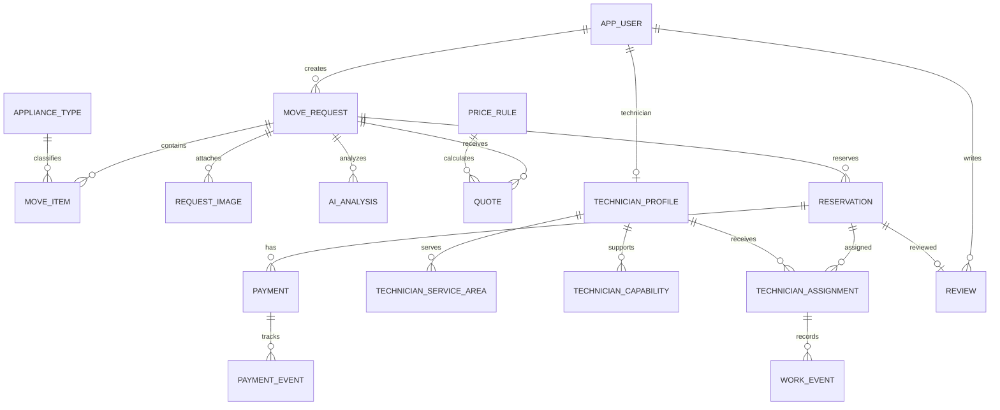

# 데이터베이스 설계서 (Database Design)

- 프로젝트: AI 기반 가전제품 이전설치 플랫폼 (Appliance Installation Platform)
- 문서 버전: 1.0
- 작성일: 2026-10-19
- 대상 단계: PoC / MVP
- 기준 문서: `docs/requirements.md`, `docs/architecture.md`

## 1. 목적 및 설계 원칙

본 문서는 PostgreSQL 데이터 모델, 테이블 관계, 주요 컬럼, 제약조건 및 데이터 관리 원칙을 정의한다.

1. 업무의 중심 Aggregate Root는 `move_request`(이전설치 요청)로 둔다.
2. 회원, 제품, 요청, 이미지/AI 분석, 가격 규칙/견적, 예약, 결제, 기사/배정, 작업 이력을 분리한다.
3. 금액은 `numeric(12,2)`로 저장하며 부동소수점 타입을 사용하지 않는다.
4. 상태값은 애플리케이션 enum과 DB 제약조건을 함께 사용한다. 상태 전이의 최종 검증은 서비스 계층에서 수행한다.
5. 주요 테이블은 `id`, `created_at`, `updated_at`을 기본으로 갖는다. 필요한 경우 `created_by`, `updated_by`, `deleted_at`을 추가한다.
6. 모든 시각은 `timestamptz`로 저장하고 API에서는 ISO-8601 형식으로 전달한다.
7. 스키마 변경은 Flyway 마이그레이션으로만 관리한다. 운영 DB에 수동 DDL을 직접 적용하지 않는다.
8. 이미지 바이너리는 DB에 저장하지 않고 S3/Azure Blob 등 객체 스토리지에 저장한다. DB에는 저장 키와 메타데이터만 저장한다.
9. 결제카드번호, CVC, 비밀번호 원문, API 비밀키는 저장하지 않는다.
10. 개인정보 보관·삭제 정책은 별도 운영 정책으로 확정하고 적용한다.

## 2. 데이터베이스 기준

| 항목 | 기준 |
|---|---|
| DBMS | PostgreSQL 16 권장 |
| 기본 스키마 | `public` 또는 프로젝트 전용 스키마(배포 전 확정) |
| 문자 인코딩 | UTF-8 |
| PK | `uuid` |
| 시간 | `timestamptz` |
| 금액 | `numeric(12,2)` |
| Boolean | `boolean` |
| JSON | 유연한 AI 분석 결과·가격 조건에 한해 `jsonb` |
| DDL 관리 | Flyway |
| ORM | Spring Data JPA 기준. 복잡 조회는 명시적 쿼리 허용 |

UUID 생성은 애플리케이션에서 수행하거나 PostgreSQL UUID 함수를 사용한다. 두 방식을 한 테이블에서 혼용하지 않는다.

## 3. 논리 ERD



## 4. 테이블 목록

| 영역 | 테이블 | 설명 |
|---|---|---|
| 회원/권한 | `app_user` | 고객·기사·관리자 계정 |
| 회원/권한 | `user_role` | 사용자 역할 매핑 |
| 가전 기준정보 | `appliance_type` | 에어컨·냉장고·세탁기 등 |
| 이전설치 | `move_request` | 이전설치 업무 Root |
| 이전설치 | `move_item` | 요청별 가전제품과 설치 조건 |
| 파일/AI | `request_image` | 이미지 저장 위치 및 메타데이터 |
| 파일/AI | `ai_analysis` | AI 분석 요청과 결과 |
| 견적 | `price_rule` | 가격 규칙 및 유효기간 |
| 견적 | `quote` | 견적 헤더·총액·계산 스냅샷 |
| 견적 | `quote_line` | 견적 상세 비용 항목 |
| 예약 | `reservation` | 희망 일정, 예약 상태 |
| 결제 | `payment` | 결제 시도 및 현재 상태 |
| 결제 | `payment_event` | 결제사 응답·웹훅 처리 이력 |
| 기사 | `technician_profile` | 기사 프로필 및 승인 상태 |
| 기사 | `technician_service_area` | 기사 서비스 지역 |
| 기사 | `technician_capability` | 취급 가능한 가전 품목 |
| 배정/작업 | `technician_assignment` | 예약별 기사 배정 |
| 배정/작업 | `work_event` | 배정·수락·작업·완료 이력 |
| 리뷰 | `review` | 완료 예약에 대한 고객 리뷰 |
| 공통 운영 | `audit_log` | 중요 업무 변경 이력(필요 시) |

## 5. 테이블 상세

### 5.1 `app_user` — 사용자

| 컬럼 | 타입 | 필수 | 설명 |
|---|---|---:|---|
| `id` | uuid | Y | PK |
| `email` | varchar(254) | Y | 로그인 이메일, unique |
| `password_hash` | varchar(255) | Y | 단방향 해시 |
| `name` | varchar(100) | Y | 이름 |
| `phone` | varchar(30) | Y | 연락처 |
| `status` | varchar(20) | Y | `ACTIVE`, `SUSPENDED`, `WITHDRAWN` |
| `email_verified_at` | timestamptz | N | 이메일 인증 시각 |
| `last_login_at` | timestamptz | N | 마지막 로그인 |
| `created_at` | timestamptz | Y | 생성 시각 |
| `updated_at` | timestamptz | Y | 수정 시각 |
| `deleted_at` | timestamptz | N | 논리 삭제 시각 |

제약조건: `UNIQUE(email)`(대소문자 정규화 정책 적용), status CHECK. 비밀번호 원문은 절대 저장하지 않는다.

### 5.2 `user_role` — 사용자 역할

| 컬럼 | 타입 | 필수 | 설명 |
|---|---|---:|---|
| `user_id` | uuid | Y | FK → `app_user.id` |
| `role_code` | varchar(20) | Y | `CUSTOMER`, `TECHNICIAN`, `ADMIN` |
| `created_at` | timestamptz | Y | 부여 시각 |

PK: (`user_id`, `role_code`). 역할 검증은 서버에서 수행한다.

### 5.3 `appliance_type` — 가전제품 종류

| 컬럼 | 타입 | 필수 | 설명 |
|---|---|---:|---|
| `id` | uuid | Y | PK |
| `code` | varchar(40) | Y | 고유 코드 |
| `name` | varchar(100) | Y | 표시명 |
| `description` | text | N | 설명 |
| `active` | boolean | Y | 사용 여부 |
| `display_order` | integer | Y | 표시 순서 |
| `created_at` / `updated_at` | timestamptz | Y | 생성·수정 시각 |

예: `AIR_CONDITIONER`, `REFRIGERATOR`, `WASHING_MACHINE`, `TV`. 코드 값은 API 계약과 동일하게 유지한다.

### 5.4 `move_request` — 이전설치 요청

| 컬럼 | 타입 | 필수 | 설명 |
|---|---|---:|---|
| `id` | uuid | Y | PK |
| `request_no` | varchar(30) | Y | 사용자 표시용 요청번호, unique |
| `customer_id` | uuid | Y | FK → `app_user.id` |
| `status` | varchar(30) | Y | 요청 상태 |
| `origin_address` | varchar(500) | Y | 출발지 주소 |
| `origin_address_detail` | varchar(300) | N | 출발지 상세주소 |
| `destination_address` | varchar(500) | Y | 도착지 주소 |
| `destination_address_detail` | varchar(300) | N | 도착지 상세주소 |
| `desired_start_at` | timestamptz | Y | 희망 작업 시작 |
| `desired_end_at` | timestamptz | N | 희망 작업 종료/시간대 끝 |
| `customer_memo` | text | N | 요청 메모 |
| `submitted_at` | timestamptz | N | 접수 시각 |
| `created_at` / `updated_at` | timestamptz | Y | 생성·수정 시각 |

상태: `DRAFT`, `SUBMITTED`, `ANALYZING`, `NEEDS_REVIEW`, `QUOTED`, `RESERVED`, `IN_PROGRESS`, `COMPLETED`, `CANCELLED`.

인덱스: `(customer_id, created_at DESC)`, `(status, desired_start_at)`. 상태 전이는 서비스에서 검증한다.

### 5.5 `move_item` — 요청별 가전제품

| 컬럼 | 타입 | 필수 | 설명 |
|---|---|---:|---|
| `id` | uuid | Y | PK |
| `move_request_id` | uuid | Y | FK → `move_request.id` |
| `appliance_type_id` | uuid | Y | FK → `appliance_type.id` |
| `manufacturer` | varchar(100) | N | 제조사 |
| `model_name` | varchar(150) | N | 모델명 |
| `quantity` | integer | Y | 수량, 1 이상 |
| `width_mm` / `height_mm` / `depth_mm` | integer | N | 치수(mm) |
| `installation_conditions` | jsonb | N | 실외기·배관·엘리베이터 등 조건 |
| `created_at` / `updated_at` | timestamptz | Y | 생성·수정 시각 |

인덱스: `(move_request_id)`. 설치 조건 JSON 키는 API DTO에서 명시적으로 정의하고 임의 구조를 허용하지 않는다.

### 5.6 `request_image` — 요청 이미지

| 컬럼 | 타입 | 필수 | 설명 |
|---|---|---:|---|
| `id` | uuid | Y | PK |
| `move_request_id` | uuid | Y | FK → `move_request.id` |
| `move_item_id` | uuid | N | FK → `move_item.id` |
| `storage_provider` | varchar(20) | Y | `S3`, `AZURE_BLOB`, `LOCAL` |
| `object_key` | varchar(1000) | Y | 저장소 객체 키 |
| `original_filename` | varchar(255) | Y | 원본 파일명 |
| `content_type` | varchar(100) | Y | 허용 MIME 타입 |
| `size_bytes` | bigint | Y | 바이트 크기 |
| `purpose` | varchar(30) | Y | `APPLIANCE`, `INSTALLATION_ENV`, `WORK_PROOF` |
| `uploaded_by` | uuid | Y | FK → `app_user.id` |
| `created_at` | timestamptz | Y | 업로드 시각 |

DB에는 공개 URL 대신 객체 키를 저장한다. 다운로드는 권한 확인 후 만료시간이 있는 서명 URL 등을 사용한다.

### 5.7 `ai_analysis` — AI 분석

| 컬럼 | 타입 | 필수 | 설명 |
|---|---|---:|---|
| `id` | uuid | Y | PK |
| `move_request_id` | uuid | Y | FK → `move_request.id` |
| `status` | varchar(20) | Y | `PENDING`, `RUNNING`, `SUCCEEDED`, `FAILED`, `NEEDS_REVIEW` |
| `provider` | varchar(40) | Y | AI 제공자 |
| `model_name` | varchar(100) | N | 모델 식별자 |
| `input_snapshot` | jsonb | Y | 분석에 전달한 입력 요약 |
| `result_json` | jsonb | N | 구조화된 결과 |
| `confidence` | numeric(5,4) | N | 0~1 신뢰도 |
| `error_code` | varchar(100) | N | 오류 코드 |
| `error_message` | text | N | 비밀정보를 제외한 오류 요약 |
| `started_at` / `completed_at` | timestamptz | N | 시작·완료 시각 |
| `created_at` | timestamptz | Y | 생성 시각 |

인덱스: `(move_request_id, created_at DESC)`, `(status, created_at)`. AI 결과는 참고 정보이며 가격·설치 가능 여부의 최종 결정은 규칙과 업무 검증을 통해 수행한다.

### 5.8 `price_rule` — 가격 규칙

| 컬럼 | 타입 | 필수 | 설명 |
|---|---|---:|---|
| `id` | uuid | Y | PK |
| `rule_code` | varchar(60) | Y | 고유 규칙 코드 |
| `name` | varchar(150) | Y | 규칙명 |
| `description` | text | N | 설명 |
| `conditions` | jsonb | Y | 적용 조건 |
| `calculation_type` | varchar(20) | Y | `FIXED`, `PER_UNIT`, `PERCENTAGE` 등 |
| `amount` | numeric(12,2) | Y | 계산 기준 금액/값 |
| `priority` | integer | Y | 적용 우선순위 |
| `active` | boolean | Y | 활성 여부 |
| `valid_from` / `valid_to` | timestamptz | N | 유효 기간 |
| `created_by` | uuid | Y | FK → `app_user.id` |
| `created_at` / `updated_at` | timestamptz | Y | 생성·수정 시각 |

가격 규칙 변경 시 과거 견적을 재계산하지 않는다. 계산에 사용된 규칙 버전과 조건·결과는 `quote` 스냅샷에 남긴다.

### 5.9 `quote` — 견적

| 컬럼 | 타입 | 필수 | 설명 |
|---|---|---:|---|
| `id` | uuid | Y | PK |
| `quote_no` | varchar(30) | Y | 견적번호, unique |
| `move_request_id` | uuid | Y | FK → `move_request.id` |
| `version_no` | integer | Y | 요청별 견적 버전 |
| `status` | varchar(20) | Y | `DRAFT`, `ISSUED`, `ACCEPTED`, `EXPIRED`, `CANCELLED` |
| `subtotal_amount` | numeric(12,2) | Y | 공급가/소계 |
| `discount_amount` | numeric(12,2) | Y | 할인 |
| `tax_amount` | numeric(12,2) | Y | 세금 |
| `total_amount` | numeric(12,2) | Y | 최종 합계 |
| `currency` | char(3) | Y | 기본 `KRW` |
| `calculation_snapshot` | jsonb | Y | 적용 규칙·입력·계산 결과 |
| `issued_at` / `expires_at` | timestamptz | N | 발행·만료 시각 |
| `created_at` / `updated_at` | timestamptz | Y | 생성·수정 시각 |

제약조건: `UNIQUE(move_request_id, version_no)`, 금액은 0 이상. `total_amount`는 서버 계산 결과이며 클라이언트 금액을 신뢰하지 않는다.

### 5.10 `quote_line` — 견적 상세

| 컬럼 | 타입 | 필수 | 설명 |
|---|---|---:|---|
| `id` | uuid | Y | PK |
| `quote_id` | uuid | Y | FK → `quote.id` |
| `line_code` | varchar(60) | Y | 비용 항목 코드 |
| `description` | varchar(255) | Y | 항목 설명 |
| `quantity` | numeric(10,2) | Y | 수량 |
| `unit_price` | numeric(12,2) | Y | 단가 |
| `line_amount` | numeric(12,2) | Y | 항목 금액 |
| `rule_snapshot` | jsonb | N | 적용 규칙 스냅샷 |

### 5.11 `reservation` — 예약

| 컬럼 | 타입 | 필수 | 설명 |
|---|---|---:|---|
| `id` | uuid | Y | PK |
| `reservation_no` | varchar(30) | Y | 예약번호, unique |
| `move_request_id` | uuid | Y | FK → `move_request.id` |
| `quote_id` | uuid | Y | FK → `quote.id` |
| `status` | varchar(30) | Y | 예약 상태 |
| `scheduled_start_at` | timestamptz | Y | 예약 시작 |
| `scheduled_end_at` | timestamptz | Y | 예약 종료 |
| `customer_memo` | text | N | 예약 메모 |
| `confirmed_at` | timestamptz | N | 확정 시각 |
| `cancelled_at` | timestamptz | N | 취소 시각 |
| `created_at` / `updated_at` | timestamptz | Y | 생성·수정 시각 |

상태: `PENDING`, `CONFIRMED`, `RESCHEDULE_REQUESTED`, `CANCELLED`, `EXPIRED`, `COMPLETED`. 동시 예약 방지는 Redis Lock을 보조적으로 사용하고 DB 트랜잭션 및 충돌 검증을 최종 방어선으로 둔다.

### 5.12 `payment` — 결제

| 컬럼 | 타입 | 필수 | 설명 |
|---|---|---:|---|
| `id` | uuid | Y | PK |
| `reservation_id` | uuid | Y | FK → `reservation.id` |
| `payment_provider` | varchar(30) | Y | 예: `TOSS_PAYMENTS` |
| `order_id` | varchar(100) | Y | 내부 주문 ID, unique |
| `payment_key` | varchar(200) | N | 결제사 키, unique when present |
| `amount` | numeric(12,2) | Y | 서버가 산정한 결제 금액 |
| `status` | varchar(30) | Y | 결제 상태 |
| `method` | varchar(40) | N | 결제 수단 |
| `approved_at` | timestamptz | N | 승인 시각 |
| `cancelled_amount` | numeric(12,2) | Y | 누적 취소 금액 |
| `idempotency_key` | varchar(100) | Y | 중복 요청 방지 키 |
| `created_at` / `updated_at` | timestamptz | Y | 생성·수정 시각 |

상태: `READY`, `IN_PROGRESS`, `PAID`, `FAILED`, `CANCEL_REQUESTED`, `CANCELLED`, `PARTIALLY_REFUNDED`, `REFUNDED`. `UNIQUE(idempotency_key)`를 적용한다. 결제 취소와 환불은 같은 개념으로 처리하지 않는다.

### 5.13 `payment_event` — 결제 이벤트

결제 승인 응답, 취소 응답, 웹훅 수신 및 중복 처리 여부를 기록한다. 주요 컬럼은 `id`, `payment_id`, `provider_event_id`, `event_type`, `payload_summary jsonb`, `processed_at`, `processing_status`, `created_at`이다. 결제사 원문 payload를 저장해야 할 경우 개인정보·비밀정보를 제거하고 보관 기간을 제한한다. `provider_event_id`는 제공되는 경우 unique로 둔다.

### 5.14 기사 및 배정 테이블

- `technician_profile`: `id`, `user_id`(unique FK), `approval_status`, `business_name`, `license_info`(필요 시 최소 정보), `active`, timestamps.
- `technician_service_area`: `id`, `technician_id`, `region_code`, `active`; `(technician_id, region_code)` unique.
- `technician_capability`: `technician_id`, `appliance_type_id`, `active`; 복합 PK.
- `technician_assignment`: `id`, `reservation_id`, `technician_id`, `status`, `assigned_at`, `responded_at`, `completed_at`, `rejection_reason`, timestamps.
- `work_event`: `id`, `assignment_id`, `event_type`, `note`, `evidence_image_id`(nullable FK), `created_by`, `created_at`.

기사 자동 매칭은 MVP에서 품목·지역·일정·승인 상태와 충돌 여부를 기준으로 규칙 기반 처리한다. AI 최적화는 추후 확장한다.

### 5.15 `review` — 리뷰

`id`, `reservation_id`(unique FK), `customer_id`(FK), `rating`(1~5), `content`, `created_at`, `updated_at`. 완료된 예약의 고객만 리뷰를 등록할 수 있도록 서비스 계층에서 검증한다.

### 5.16 `audit_log` — 감사 로그(권장)

`id`, `actor_user_id`, `action`, `entity_type`, `entity_id`, `request_id`, `before_summary jsonb`, `after_summary jsonb`, `created_at`. 비밀번호·토큰·카드정보 등 비밀정보는 기록하지 않는다.

## 6. 주요 인덱스 및 제약조건

- 모든 PK/FK에 적절한 인덱스를 둔다. PostgreSQL은 FK 컬럼 인덱스를 자동 생성하지 않으므로 조회·삭제 패턴에 따라 명시적으로 추가한다.
- `app_user.email`, 각 업무 번호(`request_no`, `quote_no`, `reservation_no`, `order_id`)는 unique.
- 요청 목록: `move_request(customer_id, created_at DESC)`.
- 운영 현황: `move_request(status, created_at)`, `reservation(status, scheduled_start_at)`.
- 분석 대기: `ai_analysis(status, created_at)`.
- 예약 슬롯 충돌은 단순 인덱스만으로 보장되지 않으므로 트랜잭션·잠금·충돌 검증을 함께 구현한다. 기사별 겹치는 작업을 엄격히 방지해야 할 경우 PostgreSQL range/exclusion constraint 도입을 별도 검토한다.
- 삭제 대신 상태 변경 또는 논리 삭제를 기본으로 하되 법령·개인정보 정책에 따른 삭제 절차를 정의한다.

## 7. 상태 관리 원칙

상태는 단순 문자열 변경이 아니라 허용된 전이로 관리한다. 전이 로직은 도메인 서비스의 단일 메서드에서 검증하고, 변경 이벤트를 필요한 경우 이력 테이블에 기록한다.

- `move_request.status`, `reservation.status`, `payment.status`는 서로 독립적으로 관리한다.
- 결제 성공이 예약 확정의 전제인지 여부는 예약 정책에서 명시한다.
- 환불 승인과 예약 취소는 별도 단계로 기록한다.
- 중복 웹훅 및 재시도 요청은 멱등하게 처리한다.

## 8. Flyway 마이그레이션

현재 스키마는 아래 마이그레이션으로 관리한다. `docker compose up`은 PostgreSQL 준비를 확인한 뒤 `migrate` 서비스를 실행하며, 백엔드도 시작 시 동일한 Flyway 마이그레이션을 적용한다.

```text
backend/src/main/resources/db/migration/
  V1__create_platform_schema.sql
```

기존 DB 볼륨에 마이그레이션을 적용하려면 `docker compose up -d db migrate`를 실행한다. 최초 생성 전용 초기화 스크립트 대신 Flyway 이력을 사용하므로 이미 생성된 `pgdata`에도 적용할 수 있다.

운영 규칙:
1. 이미 배포된 마이그레이션 파일은 수정하지 않고 새 버전을 추가한다.
2. 개발 DB 초기화와 운영 DB 마이그레이션을 구분한다.
3. 마이그레이션은 CI에서 빈 DB 및 이전 버전 DB 대상으로 검증한다.
4. 대량 데이터 변경은 잠금·실행시간·롤백 계획을 검토한다.

## 9. 미확정 항목

다음은 요구사항에서 구체값이 정해지지 않았으므로 구현 착수 전 결정한다.

- 주소 정규화 및 우편번호/좌표 제공자
- 예약 슬롯 단위, 작업 소요시간 산정 방식
- 세금 포함/별도 표시 정책 및 통화
- 견적 유효기간과 재견적 정책
- 환불·취소 수수료 정책
- 이미지 파일 크기·형식·보존 기간
- 개인정보 보유 기간 및 탈퇴 후 처리
- 기사 자격정보의 종류와 검증 절차
